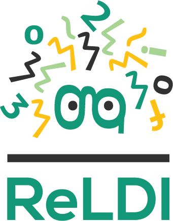
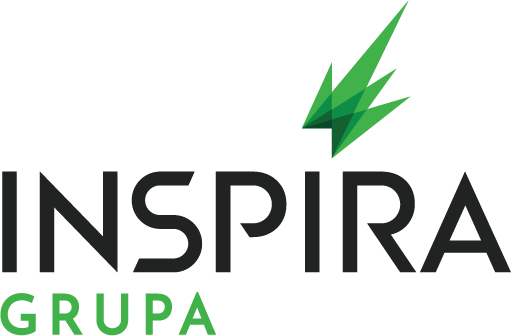

# COMtext.SR project

*[Project documentation in Serbian](https://github.com/ICEF-NLP/COMtext.SR/blob/main/README.sr.md)*

The **COMtext.SR** project aims to develop basic resources and tools for the automated processing of the Serbian language, including both the Ekavian and the Ijekavian pronunciation. Project outputs are made publicly available under a commercially permissive license.

The project focuses on text domains that have not been previously considered in either academic or commercial publicly available resources and tools for Serbian, such as legal/administrative, medical, financial, etc.

With that goal in mind, this project connects and aligns a wider community (IT industry, NGOs, academic researchers) that contributes to the project through domain expertise, financial support, and donation of intellectual property.

# Vision

The vision of this project is to open up the broad possibilities of IT product development based on the processing and understanding of the Serbian language - from quicker integration of language tools into the existing IT systems, to laying the groundwork for startups that would offer new market solutions, to improving the conditions for further research and development of Serbian language technologies.

We want future generations to be able to operate the devices around them using Serbian, and to live better and work more productively using natural language processing and understanding.

# Methodology

The best results in natural language processing are obtained by large language models (e.g. GPT, BERT, etc.) which have been trained on vast quantities of unlabeled texts. However, to successfully apply such models to specific tasks, they need to first be fine-tuned using smaller datasets that have been specially labeled for the chosen task and domain. The **COMtext.SR** project is focused precisely on the development of tailored, representative and expert-verified labeled datasets and their use in fine-tuning large language models.

# Results

The **COMtext.SR** project started with a focus on the domain of legal texts, as the most common point of interest for the largest number of project partners, as well as a huge number of government institutions and other organizations.

## Annotated data

We created the first corpus of legal texts in Serbian that has been manually annotated for morphosyntax (according to the [Multext-East v6](http://nl.ijs.si/ME/V6/) standard) and lemmas (basic word forms). The selection of representative legal texts of various types (contracts, verdicts, complaints, laws, judicial decisions, court orders, regulations, proposals, agreements, appeals, records, legal positions, etc.) that were included in the corpus was performed with assistance from the law firm [Karanović & Partners](http://www.karanovicpartners.com). The corpus is comprised of 79 documents, which contain 4762 sentences in total, or 105470 tokens. The corpus has been created in parallel variants for both pronunciations of Serbian - Ekavian and Ijekavian.

The following table gives an overview of the new **COMtext.SR.legal** corpus and its comparison with previous similarly annotated corpora of Serbian belonging to other text domains.

| Corpus                                                      | Document count | Sentence count | Token count | Text domain | Pronunciation of Serbian                          |
| :---------------------------------------------------------: | :------------: | :------------: | :---------: | :---------: | :-----------------------------------------------: |
| [SETimes.SR 2.0](http://hdl.handle.net/11356/1843)          | 176            | 4384           | 97673       | newswire    | Ekavian                                           |
| [ReLDI-NormTagNER-sr 3.0](http://hdl.handle.net/11356/1794) | 3748           | 6899           | 92271       | Twitter     | Ekavian                                           |
| **COMtext.SR.legal**                                        | 79             | 4761           | 105470      | legal       | Ekavian and Ijekavian, separate parallel variants |

----------

The **COMtext.SR.legal** annotated corpus is available for download in the connlu format:
- [**COMtext.SR.legal.ekavica.conllu**](https://github.com/ICEF-NLP/COMtext.SR/blob/main/data/comtext.sr.legal.ekavica.conllu)
- [**COMtext.SR.legal.ijekavica.conllu**](https://github.com/ICEF-NLP/COMtext.SR/blob/main/data/comtext.sr.legal.ijekavica.conllu)

Plain texts of the documents within this corpus, without the accompanying annotations, are also available:
- [**COMtext.SR.legal.ekavica Plain Texts**](https://github.com/ICEF-NLP/COMtext.SR/blob/main/data/ekavica)
- [**COMtext.SR.legal.ijekavica Plain Texts**](https://github.com/ICEF-NLP/COMtext.SR/blob/main/data/ijekavica)

## Models

Using the created annotated corpus, we fine-tuned the [BERTić](http://huggingface.co/classla/bcms-bertic) model on the tasks of mophosyntactic tagging and lemmatization of Serbian legal texts. These fine-tuned model variants are available on the HuggingFace repository.
- Morphosyntactic tagging of Serbian legal texts:
    - **[BERTić-COMtext-SR-legal-MSD-ekavica](http://huggingface.co/ICEF-NLP/bcms-bertic-comtext-sr-legal-msd-ekavica)**
    - **[BERTić-COMtext-SR-legal-MSD-ijekavica](http://huggingface.co/ICEF-NLP/bcms-bertic-comtext-sr-legal-msd-ijekavica)**
- Lemmatization of Serbian legal texts:
    - **[BERTić-COMtext-SR-legal-lemma-ekavica](http://huggingface.co/ICEF-NLP/bcms-bertic-comtext-sr-legal-lemma-ekavica)**
    - **[BERTić-COMtext-SR-legal-lemma-ijekavica](http://huggingface.co/ICEF-NLP/bcms-bertic-comtext-sr-legal-lemma-ijekavica)**

### Evaluation of morphosyntactic tagging and lemmatization

Different models and approaches have been evaluated and compared on the mentioned tasks. Lemmatization was considered both in the traditional form - using the predicted morphosyntactic tags and inflectional lexicons [srLex](http://hdl.handle.net/11356/1233) and [hrLex](http://hdl.handle.net/11356/1232),  - and also as a task of predicting string transformations of the input word in order to lemmatize it. Model predictions were evaluated with gold tokenization and alternatively by relying on the currently best publicly available tokenizer for Serbian - [ReLDI/CLASSLA tokenizer](http://github.com/clarinsi/reldi-tokeniser). *Accuracy* (ACC) and [*Word Error Rate* (WER)](http://en.wikipedia.org/wiki/Word_error_rate) are used as the performance metrics. In addition to different variants of [BERTić](http://huggingface.co/classla/bcms-bertic) and ModernBERTić ([large](https://huggingface.co/permitt/galton-modernbertic-large) and [base](https://huggingface.co/permitt/galton-modernbertic-base)), we considered the [SrBERTa](https://huggingface.co/JelenaTosic/SRBerta) and [Pripravnik-157](https://huggingface.co/procesaur/pripravnik157) models, which were pre-trained on Serbian legal texts, as well as the [CLASSLA](http://pypi.org/project/classla/) and [Trankit](https://github.com/nlp-uoregon/trankit) libraries as baselines. This repo contains the source code used in model fine-tuning and evaluation. We also make available a [model usage demonstration](https://github.com/ICEF-NLP/COMtext.SR/blob/main/examples/) in the form of a Jupyter Notebook.

#### Evaluation results - morphosyntactic tagging - Ekavian

| Fine-tuning data |        Model       | MSD ACC (Gold) |  MSD WER (Gold) | MSD WER (End-to-end) |
| :--------------: | :----------------: | :------------: | :-------------: | :------------------: |
| COMtext.SR.legal | ModernBERTić-large |   **97.42**    |    **2.58**     |       **4.06**       |
| COMtext.SR.legal | ModernBERTić-base  |     97.11      |      2.89       |         4.22         |
| COMtext.SR.legal | BERTić             |     96.87      |      3.13       |         4.31         |
| COMtext.SR.legal | Pripravnik-157     |     94.66      |      5.34       |         6.71         |
| COMtext.SR.legal | SRBerta            |     94.02      |      5.98       |         7.37         |
|  SETimes.SR 2.0  | ModernBERTić-large |     93.03      |      6.97       |         8.01         |
|  SETimes.SR 2.0  | BERTić             |     92.14      |      7.86       |         8.94         |
|        /         | CLASSLA-SR         |     91.44      |      8.56       |         9.83         |
|        /         | Trankit-SR         |     90.91      |      9.09       |         9.94         |

#### Evaluation results - morphosyntactic tagging - Ijekavian

| Fine-tuning data |        Model       | MSD ACC (Gold) |  MSD WER (Gold) | MSD WER (End-to-end) |
| :--------------: | :----------------: | :------------: | :-------------: | :------------------: |
| COMtext.SR.legal | ModernBERTić-large |   **97.42**    |    **2.58**     |       **4.05**       |
| COMtext.SR.legal | ModernBERTić-base  |     95.87      |      4.13       |         4.33         |
| COMtext.SR.legal | BERTić             |     96.91      |      3.09       |         4.33         |
| COMtext.SR.legal | Pripravnik-157     |     94.68      |      5.32       |         7.40         |
| COMtext.SR.legal | SRBerta            |     94.04      |      5.96       |         8.00         |
|  SETimes.SR 2.0  | ModernBERTić-large |     93.03      |      6.97       |         8.02         |
|  SETimes.SR 2.0  | BERTić             |     92.16      |      7.84       |         8.94         |
|        /         | CLASSLA-SR         |     91.53      |      8.47       |         9.74         |
|        /         | CLASSLA-HR         |     90.63      |      9.37       |        10.73         |
|        /         | Trankit-SR         |     91.04      |      8.96       |         9.81         |
|        /         | Trankit-HR         |     91.59      |      8.41       |        10.24         |

#### Evaluation results - lemmatization - Ekavian

| Fine-tuning data | Lemmatization approach |        Model       | Lemma ACC (Gold) |  Lemma WER (Gold) | Lemma WER (End-to-end) |
| :--------------: | :--------------------: | :----------------: | :--------------: | :---------------: | :--------------------: |
| COMtext.SR.legal | String transformation  | ModernBERTić-large |    **98.89**     |     **1.11**      |        **2.19**        |
| COMtext.SR.legal | String transformation  | ModernBERTić-base  |      98.87       |       1.13        |          2.56          |
| COMtext.SR.legal | String transformation  | BERTić             |      98.73       |       1.27        |          2.38          |
| COMtext.SR.legal | String transformation  | Pripravnik-157     |      97.86       |       2.14        |          3.41          |
| COMtext.SR.legal | String transformation  | SRBerta            |      97.17       |       2.83        |          4.09          |
| COMtext.SR.legal |      MSD + srLex       | ModernBERTić-large |      96.67       |       3.33        |          5.20          |
| COMtext.SR.legal |      MSD + srLex       | ModernBERTić-base  |      96.62       |       3.38        |          5.21          |
| COMtext.SR.legal |      MSD + srLex       | BERTić             |      96.64       |       3.36        |          5.24          |
| COMtext.SR.legal |      MSD + srLex       | Pripravnik-157     |      95.69       |       4.31        |          6.40          |
| COMtext.SR.legal |      MSD + srLex       | SRBerta            |      95.65       |       4.35        |          6.46          |
|  SETimes.SR 2.0  |      MSD + srLex       | ModernBERTić-large |      96.48       |       3.52        |          5.40          |
|  SETimes.SR 2.0  |      MSD + srLex       | BERTić             |      96.50       |       3.50        |          5.37          |
|        /         |       Baseline         | CLASSLA-SR         |      91.28       |       8.72        |         10.42          |
|        /         |       Baseline         | Trankit-SR         |      89.09       |      10.90        |         12.75          |

#### Evaluation results - lemmatization - Ijekavian

| Fine-tuning data | Lemmatization approach |        Model       | Lemma ACC (Gold) |  Lemma WER (Gold) | Lemma WER (End-to-end) |
| :--------------: | :--------------------: | :----------------: | :--------------: | :---------------: | :--------------------: |
| COMtext.SR.legal | String transformation  | ModernBERTić-large |    **98.87**     |     **1.13**      |        **2.22**        |
| COMtext.SR.legal | String transformation  | ModernBERTić-base  |      98.85       |       1.15        |          2.51          |
| COMtext.SR.legal | String transformation  | BERTić             |      98.72       |       1.28        |          2.40          |
| COMtext.SR.legal | String transformation  | Pripravnik-157     |      97.83       |       2.17        |          3.97          |
| COMtext.SR.legal | String transformation  | SRBerta            |      97.27       |       2.73        |          4.50          |
| COMtext.SR.legal |      MSD + srLex       | ModernBERTić-large |      92.55       |       7.45        |          9.33          |
| COMtext.SR.legal |      MSD + srLex       | ModernBERTić-base  |      92.55       |       7.45        |          9.34          |
| COMtext.SR.legal |      MSD + srLex       | BERTić             |      92.52       |       7.48        |          9.38          |
| COMtext.SR.legal |      MSD + srLex       | Pripravnik-157     |      91.61       |       8.39        |         11.24          |
| COMtext.SR.legal |      MSD + srLex       | SRBerta            |      91.53       |       8.47        |         11.32          |
| COMtext.SR.legal |      MSD + hrLex       | ModernBERTić-large |      94.54       |       5.46        |          7.35          |
| COMtext.SR.legal |      MSD + hrLex       | ModernBERTić-base  |      94.54       |       5.46        |          7.35          |
| COMtext.SR.legal |      MSD + hrLex       | BERTić             |      94.52       |       5.48        |          7.39          |
| COMtext.SR.legal |      MSD + hrLex       | Pripravnik-157     |      93.62       |       6.38        |          9.24          |
| COMtext.SR.legal |      MSD + hrLex       | SRBerta            |      93.53       |       6.47        |          9.33          |
|  SETimes.SR 2.0  |      MSD + srLex       | ModernBERTić-large |      92.34       |       7.66        |          9.55          |
|  SETimes.SR 2.0  |      MSD + srLex       | BERTić             |      92.36       |       7.64        |          9.52          |
|  SETimes.SR 2.0  |      MSD + hrLex       | ModernBERTić-large |      94.34       |       5.66        |          7.55          |
|  SETimes.SR 2.0  |      MSD + hrLex       | BERTić             |      94.35       |       5.65        |          7.52          |
|        /         |       Baseline         | CLASSLA-SR         |      87.35       |      12.65        |         14.35          |
|        /         |       Baseline         | CLASSLA-HR         |      90.59       |       9.41        |         11.21          |
|        /         |       Baseline         | Trankit-SR         |      88.17       |      11.82        |         13.69          |
|        /         |       Baseline         | Trankit-HR         |      89.01       |      10.98        |         13.43          |

## License

All datasets developed within the **COMtext.SR** project are made publicly available under the [CC-BY 4.0 International](http://creativecommons.org/licenses/by/4.0/deed.sr-latn) license. All created models are available under the [Apache 2.0](http://www.apache.org/licenses/LICENSE-2.0) license. Therefore, both the data and the models can be freely used for any purposes, including commercial ones, as long as proper authorship attribution is provided.

# Who we are
The project is implemented by a consortium of the following institutions:

**[Innovation Center of the School of Electrical Engineering, University of Belgrade (ICEF)](https://www.ic.etf.bg.ac.rs/?lang=en)** is responsible for setting up and maintaining the environment for language resource development, selecting and preparing domain texts for automated processing, and implementing and publishing NLP/NLU models and tools.

**[Regional Linguistic Data Initiative (ReLDI) Centre](https://reldi.rs/en)** is responsible for the annotation of texts and manual quality evaluation of NLP/NLU model outputs.

## Contact
Contact person for **COMtext.SR** project support or collaboration in applying its outputs in software solutions and products:
* [dr Vuk Batanović](mailto:vuk.batanovic@ic.etf.bg.ac.rs), COMtext.SR project lead

# Project partners

The following organizations have supported the **COMtext.SR** project:

<table>
  <thead>
    <tr>
      <th>Partner website</th>
      <th>Partner logo</th>
    </tr>
  </thead>
  <tbody>
    <tr>
      <td>
<strong><a href="http://www.rnids.rs/en/">RNIDS</a></strong>
</td>
      <td></td>
    </tr>
    <tr>
      <td>
<strong><a href="https://osfwb.org/">Open Society Foundations Western Balkans</a></strong>
</td>
      <td></td>
    </tr>
    <tr>
      <td>
<strong><a href="http://comtradeintegration.com/en/">Comtrade System Integration</a></strong>
</td>
      <td></td>
    </tr>
    <tr>
      <td>
<strong><a href="http://www.sas.com/en_si/home.html">SAS</a></strong>
</td>
      <td></td>
    </tr>
    <tr>
      <td>
<strong><a href="http://inspiragrupa.com/en/">Inspira group</a></strong>
</td>
      <td>

</td>
    </tr>
    <tr>
      <td>
<strong><a href="http://www.karanovicpartners.com">Karanovic & Partners</a></strong>
</td>
      <td></td>
    </tr>
    <tr>
      <td>
<strong><a href="http://www.alfanum.co.rs/en/">Alfanum</a></strong>
</td>
      <td></td>
    </tr>
    <tr>
      <td>
<strong><a href="https://www.ite.gov.rs/">Office for IT and eGovernment</a></strong>
</td>
      <td></td>
    </tr>
  </tbody>
</table>
