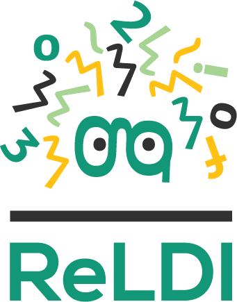
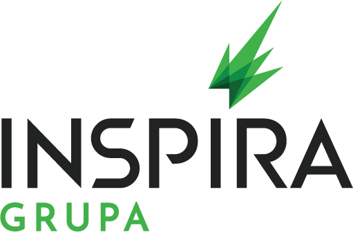

# Projekat COMtext.SR

*[Projektna dokumentacija na engleskom jeziku](https://github.com/ICEF-NLP/COMtext.SR/blob/main/README.md)*

**COMtext.SR** je projekat razvoja osnovnog skupa resursa i alata za automatsku obradu tekstova na srpskom jeziku, kako za ekavicu tako i za ijekavicu, koji će biti javno dostupni pod licencom koja omogućava njihovu upotrebu u bilo koje svrhe, uključujući komercijalne.

Fokus projekta je na domenima tekstova koji do sada nisu razmatrani bilo u akademskim bilo u komercijalnim javno dostupnim resursima i alatima za srpski jezik, kao što su pravno-administrativni, finansijski, medicinski, itd.

Sa tim ciljem na umu, ovaj projekat okuplja i sinhronizuje širu zajednicu (IT industrija, nevladine organizacije, akademski istraživači) koja doprinosi realizaciji ovog zadatka kroz doniranje stručnih i materijalnih resursa i intelektualne svojine.

# Vizija

Vizija na kojoj je ovaj projekat zasnovan jeste otvaranje širokih mogućnosti za razvoj IT proizvoda baziranih na obradi i razumevanju prirodnih jezika (engl. *Natural Language Processing/Understanding - NLP/NLU*) – od brže integracije jezičkih alata u postojeće IT sisteme, preko stvaranja uslova za pokretanje startapa koji bi tržištu ponudili nova rešenja, do unapređivanja uslova za dalja istraživanja i razvoj u domenu jezičkih tehnologija.

Želimo da buduće generacije budu u mogućnosti da uređajima oko sebe upravljaju koristeći srpski jezik, da kvalitetnije žive i efikasnije rade zahvaljujući moći računarske obrade i razumevanja prirodnog jezika.

# Metodologija

Najbolje rezultate u obradi prirodnih jezika trenutno postižu veliki jezički modeli (npr. BERT, GPT, i sl.), obučeni nad ogromnim količinama neobeleženih tekstova. Međutim, da bi se takvi modeli uspešno primenili na rešavanje konkretnih zadataka, njih je neophodno prilagoditi (engl. *fine-tuning*) uz pomoć manjih, posebno obeleženih skupova podataka specifičnih za zadatak i domen tekstova koji se razmatra. Projekat **COMtext.SR** je usmeren upravo na izradu namenskih, reprezentativnih i ekspertski proverenih označenih skupova podataka i njihovo korišćenje za izradu prilagođenih velikih jezičkih modela.

# Dosadašnji rezultati

Projekat **COMtext.SR** je otpočeo sa fokusom na pravno-administrativni domen tekstova, kao domen koji je od zajedničkog interesa za najveći broj partnera projekta, kao i za ogroman broj državnih institucija i drugih organizacija.

## Anotirani podaci

Kreiran je prvi korpus pravno-administrativnih tekstova na srpskom koji je ručno anotiran u pogledu morfosintaktičkih odlika (po [Multext-East v6](http://nl.ijs.si/ME/V6/) standardu) i lema (osnovnih oblika reči). Izbor reprezentativnih pravnih tekstova različitog tipa (ugovori, presude, zaključci, rešenja, odluke, molbe, žalbe, pravilnici, zakoni, uredbe, statuti, zapisnici, itd.) koji su uključeni u korpus sproveden je uz pomoć advokatske kancelarije [Karanović & Partners](http://www.karanovicpartners.com). U korpus je uključeno 79 dokumenata, koji zajedno sadrže 4761 rečenicu, odnosno 105470 tokena. Navedeni korpus je izrađen u paralelnim varijantama za oba izgovora srpskog jezika - ekavici i ijekavici.

U nastavku je dat pregled i poređenje novog **COMtext.SR.legal** korpusa sa sličnim prethodno izrađenim anotiranim korpusima srpskog jezika iz drugih domena:

| Korpus                                                      | Broj dokumenata | Broj rečenica | Broj tokena | Domen tekstova         | Izgovor srpskog jezika                            |
| :---------------------------------------------------------: | :-------------: | :-----------: | :---------: | :--------------------: | :-----------------------------------------------: |
| [SETimes.SR 2.0](http://hdl.handle.net/11356/1843)          | 176             | 4384          | 97673       | novinski               | ekavica                                           |
| [ReLDI-NormTagNER-sr 3.0](http://hdl.handle.net/11356/1794) | 3748            | 6899          | 92271       | Twitter                | ekavica                                           |
| **COMtext.SR.legal**                                        | 79              | 4761          | 105470      | pravno-administrativni | ekavica i ijekavica, odvojene paralelne varijante |

----------

Korpus **COMtext.SR.legal** je naknadno dopunjen oznakama imenovanih entiteta, po IOB2 standardu. U narednoj tabeli dat je pregled novorazvijene sistematizacije imenovanih entiteta u pravnom domenu i zastupljenost svakog od tipova entiteta u korpusu. Od ukupno 105470 tokena, njih 14113 (13.4%) pripada nekom imenovanom entitetu.

| Kategorija        | Potkategorija                                | Oznaka       | Broj / procenat entiteta u korpusu | Prosečna dužina u tokenima |
| ----------------- | -------------------------------------------- | ------------ | ---------------------------------- | -------------------------- |
| Osobe             |                                              | **PER**      | 694 / 19.2%                        | 1.89                       |
| Lokacije          | Toponimi                                     | **TOP**      | 294 / 8.1%                         | 1.24                       |
|                   | Adrese                                       | **ADR**      | 203 / 5.6%                         | 6.96                       |
| Organizacije      | Sudovi                                       | **COURT**    | 148 / 4.1%                         | 3.59                       |
|                   | Institucije                                  | **INST**     | 395 / 10.9%                        | 2.75                       |
|                   | Kompanije                                    | **COM**      | 337 / 9.3%                         | 2.28                       |
|                   | Ostale organizacije                          | **OTHORG**   | 97 / 2.7%                          | 2.27                       |
| Pravna dokumenta  | Opšti pravni akti                            | **LAW**      | 395 / 10.9%                        | 9.17                       |
|                   | Pojedinačni pravni akti                      | **REF**      | 227 / 6.3%                         | 10.52                      |
| Poverljivi podaci | JMBG                                         | **IDPER**    | 21 / 0.6%                          | 1.0                        |
|                   | Matični broj firme                           | **IDCOM**    | 33 / 0.9%                          | 1.0                        |
|                   | PIB                                          | **IDTAX**    | 16 / 0.4%                          | 1.0                        |
|                   | Broj računa u banci                          | **NUMACC**   | 6 / 0.2%                           | 1.0                        |
|                   | Broj lične karte/pasoša                      | **NUMDOC**   | 9 / 0.2%                           | 1.0                        |
|                   | Broj registarskih tablica/šasije             | **NUMCAR**   | 6 / 0.2%                           | 2.67                       |
|                   | Broj katastarske parcele/lista nepokretnosti | **NUMPLOT**  | 67 / 1.9%                          | 1.0                        |
|                   | Ostali ID brojevi                            | **IDOTH**    | 18 / 0.5%                          | 1.0                        |
|                   | E-mail, URL, broj telefona                   | **CONTACT**  | 8 / 0.2%                           | 1.0                        |
|                   | Datumi                                       | **DATE**     | 352 / 9.7%                         | 4.1                        |
|                   | Novčani iznosi                               | **MONEY**    | 246 / 6.8%                         | 2.32                       |
| Ostalo            |                                              | **MISC**     | 39 / 1.1%                          | 5.0                        |

----------

**COMtext.SR.legal** anotirani korpus je dostupan za preuzimanje u connlu formatu:
- [**COMtext.SR.legal.ekavica.conllu**](https://github.com/ICEF-NLP/COMtext.SR/blob/main/data/comtext.sr.legal.ekavica.conllu)
- [**COMtext.SR.legal.ijekavica.conllu**](https://github.com/ICEF-NLP/COMtext.SR/blob/main/data/comtext.sr.legal.ijekavica.conllu)

Izvorni tekstovi dokumenata iz ovog korpusa, bez pratećih anotacija, takođe su dostupni na sledećem direktorijumu:
- [**COMtext.SR.legal.ekavica Plain Texts**](https://github.com/ICEF-NLP/COMtext.SR/blob/main/data/ekavica)
- [**COMtext.SR.legal.ijekavica Plain Texts**](https://github.com/ICEF-NLP/COMtext.SR/blob/main/data/ijekavica)

## Modeli

Uz pomoć izrađenog anotiranog korpusa, sprovedeno je prilagođavanje modela [BERTić](http://huggingface.co/classla/bcms-bertic) na zadacima morfosintaktičkog označavanja, lematizacije i prepoznavanja imenovanih entiteta u pravnim tekstovima na srpskom. Tako dobijene varijante modela su dostupne na repozitorijumu HuggingFace.
- Morfosintaktičko označavanje pravnih tekstova na srpskom:
    - **[BERTić-COMtext-SR-legal-MSD-ekavica](http://huggingface.co/ICEF-NLP/bcms-bertic-comtext-sr-legal-msd-ekavica)**
    - **[BERTić-COMtext-SR-legal-MSD-ijekavica](http://huggingface.co/ICEF-NLP/bcms-bertic-comtext-sr-legal-msd-ijekavica)**
- Lematizacija pravnih tekstova na srpskom:
    - **[BERTić-COMtext-SR-legal-lemma-ekavica](http://huggingface.co/ICEF-NLP/bcms-bertic-comtext-sr-legal-lemma-ekavica)**
    - **[BERTić-COMtext-SR-legal-lemma-ijekavica](http://huggingface.co/ICEF-NLP/bcms-bertic-comtext-sr-legal-lemma-ijekavica)**
- Prepoznavanje imenovanih entiteta u pravnim tekstovima na srpskom:
    - **[BERTić-COMtext-SR-legal-NER-ekavica](http://huggingface.co/ICEF-NLP/bcms-bertic-comtext-sr-legal-ner-ekavica)**
    - **[BERTić-COMtext-SR-legal-NER-ijekavica](http://huggingface.co/ICEF-NLP/bcms-bertic-comtext-sr-legal-ner-ijekavica)**

### Evaluacija morfosintaktičkog označavanja i lematizacije

Različiti modeli i pristupi su evaluirani i upoređeni na svim pomenutim zadacima. Sprovođenje lematizacije je razmatrano kako korišćenjem prediktovanih morfosintaktičkih oznaka i flektivnih leksikona [srLex](http://hdl.handle.net/11356/1233) i [hrLex](http://hdl.handle.net/11356/1232), tako i direktnim prediktovanjem lematizacionih izmena za zadate ulazne reči. Evaluirane su predikcije modela kada je tokenizacija potpuno ispravna (gold tokenizacija), kao i kada se za tokenizaciju koristi trenutno najbolji javno dostupni tokenizator za srpski - [ReLDI/CLASSLA tokenizator](http://github.com/clarinsi/reldi-tokeniser). Korišćene metrike su tačnost (engl. *accuracy*, ACC) i [*Word Error Rate* (WER)](http://en.wikipedia.org/wiki/Word_error_rate). Pored različitih varijanti [BERTića](http://huggingface.co/classla/bcms-bertic) i ModernBERTića ([large](https://huggingface.co/permitt/galton-modernbertic-large) i [base](https://huggingface.co/permitt/galton-modernbertic-base)), razmotreni su i modeli [SrBERTa](https://huggingface.co/JelenaTosic/SRBerta) i [Pripravnik-157](https://huggingface.co/procesaur/pripravnik157), koji su obučavani na pravnim tekstovima na srpskom jeziku, kao i biblioteke [CLASSLA](http://pypi.org/project/classla/) i [Trankit](https://github.com/nlp-uoregon/trankit) kao osnovna (baseline) rešenja. Ovaj repozitorijum sadrži programski kod korišćen u procesu prilagođavanja i evaluacije modela. Pored toga, dostupan je i [primer upotrebe ovih modela](https://github.com/ICEF-NLP/COMtext.SR/blob/main/examples/) u vidu Jupyter Notebook-a.

#### Rezultati evaluacije - morfosintaktičko označavanje - ekavica

| Podaci za prilagođavanje modela |        Model       | MSD ACC (Gold) |  MSD WER (Gold) | MSD WER (End-to-end) |
| :-----------------------------: | :----------------: | :------------: | :-------------: | :------------------: |
|        COMtext.SR.legal         | ModernBERTić-large |   **97.42**    |    **2.58**     |       **4.06**       |
|        COMtext.SR.legal         | ModernBERTić-base  |     97.11      |      2.89       |         4.22         |
|        COMtext.SR.legal         | BERTić             |     96.87      |      3.13       |         4.31         |
|        COMtext.SR.legal         | Pripravnik-157     |     94.66      |      5.34       |         6.71         |
|        COMtext.SR.legal         | SRBerta            |     94.02      |      5.98       |         7.37         |
|         SETimes.SR 2.0          | ModernBERTić-large |     93.03      |      6.97       |         8.01         |
|         SETimes.SR 2.0          | BERTić             |     92.14      |      7.86       |         8.94         |
|               /                 | CLASSLA-SR         |     91.44      |      8.56       |         9.83         |
|               /                 | Trankit-SR         |     90.91      |      9.09       |         9.94         |

#### Rezultati evaluacije - morfosintaktičko označavanje - ijekavica

| Podaci za prilagođavanje modela |        Model       | MSD ACC (Gold) |  MSD WER (Gold) | MSD WER (End-to-end) |
| :-----------------------------: | :----------------: | :------------: | :-------------: | :------------------: |
|        COMtext.SR.legal         | ModernBERTić-large |   **97.42**    |    **2.58**     |       **4.05**       |
|        COMtext.SR.legal         | ModernBERTić-base  |     95.87      |      4.13       |         4.33         |
|        COMtext.SR.legal         | BERTić             |     96.91      |      3.09       |         4.33         |
|        COMtext.SR.legal         | Pripravnik-157     |     94.68      |      5.32       |         7.40         |
|        COMtext.SR.legal         | SRBerta            |     94.04      |      5.96       |         8.00         |
|         SETimes.SR 2.0          | ModernBERTić-large |     93.03      |      6.97       |         8.02         |
|         SETimes.SR 2.0          | BERTić             |     92.16      |      7.84       |         8.94         |
|               /                 | CLASSLA-SR         |     91.53      |      8.47       |         9.74         |
|               /                 | CLASSLA-HR         |     90.63      |      9.37       |        10.73         |
|               /                 | Trankit-SR         |     91.04      |      8.96       |         9.81         |
|               /                 | Trankit-HR         |     91.59      |      8.41       |        10.24         |

#### Rezultati evaluacije - lematizacija - ekavica

| Podaci za prilagođavanje modela |           Pristup            |        Model       | Lemma ACC (Gold) |  Lemma WER (Gold) | Lemma WER (End-to-end) |
| :-----------------------------: | :--------------------------: | :----------------: | :--------------: | :---------------: | :--------------------: |
|        COMtext.SR.legal         | Lematizacione transformacije | ModernBERTić-large |    **98.89**     |     **1.11**      |        **2.19**        |
|        COMtext.SR.legal         | Lematizacione transformacije | ModernBERTić-base  |      98.87       |       1.13        |          2.56          |
|        COMtext.SR.legal         | Lematizacione transformacije | BERTić             |      98.73       |       1.27        |          2.38          |
|        COMtext.SR.legal         | Lematizacione transformacije | Pripravnik-157     |      97.86       |       2.14        |          3.41          |
|        COMtext.SR.legal         | Lematizacione transformacije | SRBerta            |      97.17       |       2.83        |          4.09          |
|        COMtext.SR.legal         |         MSD + srLex          | ModernBERTić-large |      96.67       |       3.33        |          5.20          |
|        COMtext.SR.legal         |         MSD + srLex          | ModernBERTić-base  |      96.62       |       3.38        |          5.21          |
|        COMtext.SR.legal         |         MSD + srLex          | BERTić             |      96.64       |       3.36        |          5.24          |
|        COMtext.SR.legal         |         MSD + srLex          | Pripravnik-157     |      95.69       |       4.31        |          6.40          |
|        COMtext.SR.legal         |         MSD + srLex          | SRBerta            |      95.65       |       4.35        |          6.46          |
|         SETimes.SR 2.0          |         MSD + srLex          | ModernBERTić-large |      96.48       |       3.52        |          5.40          |
|         SETimes.SR 2.0          |         MSD + srLex          | BERTić             |      96.50       |       3.50        |          5.37          |
|               /                 |          Baseline            | CLASSLA-SR         |      91.28       |       8.72        |         10.42          |
|               /                 |          Baseline            | Trankit-SR         |      89.09       |      10.90        |         12.75          |

#### Rezultati evaluacije - lematizacija - ijekavica

| Podaci za prilagođavanje modela |           Pristup            |        Model       | Lemma ACC (Gold) |  Lemma WER (Gold) | Lemma WER (End-to-end) |
| :-----------------------------: | :--------------------------: | :----------------: | :--------------: | :---------------: | :--------------------: |
|        COMtext.SR.legal         | Lematizacione transformacije | ModernBERTić-large |    **98.87**     |     **1.13**      |        **2.22**        |
|        COMtext.SR.legal         | Lematizacione transformacije | ModernBERTić-base  |      98.85       |       1.15        |          2.51          |
|        COMtext.SR.legal         | Lematizacione transformacije | BERTić             |      98.72       |       1.28        |          2.40          |
|        COMtext.SR.legal         | Lematizacione transformacije | Pripravnik-157     |      97.83       |       2.17        |          3.97          |
|        COMtext.SR.legal         | Lematizacione transformacije | SRBerta            |      97.27       |       2.73        |          4.50          |
|        COMtext.SR.legal         |         MSD + srLex          | ModernBERTić-large |      92.55       |       7.45        |          9.33          |
|        COMtext.SR.legal         |         MSD + srLex          | ModernBERTić-base  |      92.55       |       7.45        |          9.34          |
|        COMtext.SR.legal         |         MSD + srLex          | BERTić             |      92.52       |       7.48        |          9.38          |
|        COMtext.SR.legal         |         MSD + srLex          | Pripravnik-157     |      91.61       |       8.39        |         11.24          |
|        COMtext.SR.legal         |         MSD + srLex          | SRBerta            |      91.53       |       8.47        |         11.32          |
|        COMtext.SR.legal         |         MSD + hrLex          | ModernBERTić-large |      94.54       |       5.46        |          7.35          |
|        COMtext.SR.legal         |         MSD + hrLex          | ModernBERTić-base  |      94.54       |       5.46        |          7.35          |
|        COMtext.SR.legal         |         MSD + hrLex          | BERTić             |      94.52       |       5.48        |          7.39          |
|        COMtext.SR.legal         |         MSD + hrLex          | Pripravnik-157     |      93.62       |       6.38        |          9.24          |
|        COMtext.SR.legal         |         MSD + hrLex          | SRBerta            |      93.53       |       6.47        |          9.33          |
|         SETimes.SR 2.0          |         MSD + srLex          | ModernBERTić-large |      92.34       |       7.66        |          9.55          |
|         SETimes.SR 2.0          |         MSD + srLex          | BERTić             |      92.36       |       7.64        |          9.52          |
|         SETimes.SR 2.0          |         MSD + hrLex          | ModernBERTić-large |      94.34       |       5.66        |          7.55          |
|         SETimes.SR 2.0          |         MSD + hrLex          | BERTić             |      94.35       |       5.65        |          7.52          |
|               /                 |          Baseline            | CLASSLA-SR         |      87.35       |      12.65        |         14.35          |
|               /                 |          Baseline            | CLASSLA-HR         |      90.59       |       9.41        |         11.21          |
|               /                 |          Baseline            | Trankit-SR         |      88.17       |      11.82        |         13.69          |
|               /                 |          Baseline            | Trankit-HR         |      89.01       |      10.98        |         13.43          |

### Evaluacija prepoznavanja imenovanih entiteta

Na zadatku prepoznavanja imenovanih entiteta (NER) u pravnim tekstovima na srpskom razmatrana su za sada dva modela - [BERTić](http://huggingface.co/classla/bcms-bertic) i [SrBERTa](http://huggingface.co/nemanjaPetrovic/SrBERTa). Trajanje prilagođavanja za oba modela na ovom zadatku je 20 epoha. Korišćene metrike su tačnost (engl. *accuracy*) i F1-mera (po klasama i makro-uprosečena).

Oba modela su evaluirana u dvema postavkama:
- Default - u okviru oznake imenovanog entiteta gleda se samo tip entiteta, tj. ignorišu se "B-" i "I-" prefiksi koji označavaju da li određeni token predstavlja početak novog imenovanog entiteta ili nastavak prethodno započetog
- Strict - gleda se puna oznaka imenovanog entiteta. U ovoj postavci, F1 mera po klasama je data zasebno za B- i I- tagove za svaku klasu.

Pored toga, makro-uprosečena F1 mera je izračunata u dve varijante - jednoj u kojoj se O klasa (odsustvo bilo kog entiteta) ubraja u prosek, tj. tretira isto kao i sve druge klase, i drugoj u kojoj se ne ubraja tj. ignoriše.

#### Rezultati evaluacije - ekavica

| Metrika                | BERTić-COMtext-SR-legal-NER-ekavica (default) | BERTić-COMtext-SR-legal-NER-ekavica (strict) | SrBERTa (default) | SrBERTa (strict) |
| ---------------------- | --------------------------------------------- | -------------------------------------------- | ----------------- | ---------------- |
| Tačnost                | **0.9849**                                    | 0.9837                                       | 0.9685            | 0.9670           |
| Macro F1 (sa O klasom) | **0.8522**                                    | 0.8418                                       | 0.7270            | 0.7152           |
| Macro F1 (bez O klase) | **0.8355**                                    | 0.8335                                       | 0.7033            | 0.7028           |
| *F1 po klasama*        |                                               |                                              |                   |                  |
| PER                    | 0.9811                                        | 0.9734 / 0.9713                              | 0.8695            | 0.8216 / 0.8901  |
| LOC                    | 0.9027                                        | 0.9016 / 0.8520                              | 0.6858            | 0.6770 / 0.6557  |
| ADR                    | 0.9252                                        | 0.8803 / 0.9168                              | 0.8448            | 0.7841 / 0.8297  |
| COURT                  | 0.9450                                        | 0.9424 / 0.9408                              | 0.7809            | 0.7440 / 0.7867  |
| INST                   | 0.7848                                        | 0.7912 / 0.8087                              | 0.6346            | 0.6487 / 0.6376  |
| COM                    | 0.7577                                        | 0.6932 / 0.7435                              | 0.4719            | 0.3685 / 0.4461  |
| OTHORG                 | 0.4458                                        | 0.3223 / 0.5464                              | 0.3054            | 0.2471 / 0.3597  |
| LAW                    | 0.9583                                        | 0.9565 / 0.9572                              | 0.9133            | 0.8793 / 0.9130  |
| REF                    | 0.8315                                        | 0.7611 / 0.8200                              | 0.7706            | 0.6386 / 0.7609  |
| IDPER                  | 0.9630                                        | 0.9630 / N/A                                 | 1.0000            | 1.0000 / N/A     |
| IDCOM                  | 0.9779                                        | 0.9779 / N/A                                 | 0.9018            | 0.9018 / N/A     |
| IDTAX                  | 1.0000                                        | 1.0000 / N/A                                 | 0.9667            | 0.9667 / N/A     |
| NUMACC                 | 1.0000                                        | 1.0000 / N/A                                 | 0.6667            | 0.6667 / N/A     |
| NUMDOC                 | 0.5333                                        | 0.5333 / N/A                                 | 0.3333            | 0.3333 / N/A     |
| NUMCAR                 | 0.6111                                        | 0.5079 / 0.4286                              | 0.3879            | 0.4333 / 0.0     |
| NUMPLOT                | 0.7143                                        | 0.7143 / N/A                                 | 0.4928            | 0.4928 / N/A     |
| IDOTH                  | 0.6161                                        | 0.6161 / N/A                                 | 0.3967            | 0.3967 / N/A     |
| CONTACT                | 0.8000                                        | 0.8000 / N/A                                 | 0.1333            | 0.1333 / N/A     |
| DATE                   | 0.9602                                        | 0.9383 / 0.9544                              | 0.9491            | 0.9079 / 0.9492  |
| MONEY                  | 0.9703                                        | 0.9543 / 0.9662                              | 0.8885            | 0.8926 / 0.8852  |
| MISC                   | 0.4445                                        | 0.4032 / 0.4149                              | 0.2113            | 0.2154 / 0.1962  |
| O                      | 0.9946                                        | 0.9946                                       | 0.9870            | 0.9870           |

#### Rezultati evaluacije - ijekavica

| Metrika                | BERTić-COMtext-SR-legal-NER-ijekavica (default) | BERTić-COMtext-SR-legal-NER-ijekavica (strict) | SrBERTa (default) | SrBERTa (strict) |
| ---------------------- | ----------------------------------------------- | ---------------------------------------------- | ----------------- | ---------------- |
| Tačnost                | **0.9839**                                      | 0.9828                                         | 0.9688            | 0.9672           |
| Macro F1 (sa O klasom) | **0.8563**                                      | 0.8474                                         | 0.7479            | 0.7225           |
| Macro F1 (bez O klase) | **0.8403**                                      | 0.8396                                         | 0.7328            | 0.7128           |
| *F1 po klasama*        |                                                 |                                                |                   |                  |
| PER                    | 0.9856                                          | 0.9780 / 0.9765                                | 0.8720            | 0.8177 / 0.9068  |
| LOC                    | 0.8933                                          | 0.9003 / 0.8134                                | 0.6670            | 0.6666 / 0.5995  |
| ADR                    | 0.9253                                          | 0.9132 / 0.9161                                | 0.8554            | 0.7806 / 0.8393  |
| COURT                  | 0.9427                                          | 0.9515 / 0.9340                                | 0.8488            | 0.8417 / 0.8524  |
| INST                   | 0.8044                                          | 0.8152 / 0.8261                                | 0.6793            | 0.6376 / 0.6420  |
| COM                    | 0.7225                                          | 0.7326 / 0.6782                                | 0.4815            | 0.3632 / 0.4767  |
| OTHORG                 | 0.4670                                          | 0.3436 / 0.6080                                | 0.2557            | 0.0609 / 0.3664  |
| LAW                    | 0.9523                                          | 0.9463 / 0.9511                                | 0.9147            | 0.8868 / 0.9128  |
| REF                    | 0.8125                                          | 0.7602 / 0.7939                                | 0.7564            | 0.6246 / 0.7485  |
| IDPER                  | 1.0000                                          | 1.0000 / N/A                                   | 1.0000            | 1.0000 / N/A     |
| IDCOM                  | 0.9722                                          | 0.9722 / N/A                                   | 0.9667            | 0.9667 / N/A     |
| IDTAX                  | 1.0000                                          | 1.0000 / N/A                                   | 0.9815            | 0.9815 / N/A     |
| NUMACC                 | 1.0000                                          | 1.0000 / N/A                                   | 0.6667            | 0.6667 / N/A     |
| NUMDOC                 | 0.8148                                          | 0.8148 / N/A                                   | 0.3333            | 0.3333 / N/A     |
| NUMCAR                 | 0.6222                                          | 0.5397 / 0.5000                                | 0.4545            | 0.5000 / 0.0000  |
| NUMPLOT                | 0.7088                                          | 0.7088 / N/A                                   | 0.5479            | 0.5479 / N/A     |
| IDOTH                  | 0.5949                                          | 0.5949 / N/A                                   | 0.4776            | 0.4776 / N/A     |
| CONTACT                | 0.8000                                          | 0.8000 / N/A                                   | 0.0000            | 0.0000 / N/A     |
| DATE                   | 0.9664                                          | 0.9378 / 0.9615                                | 0.9547            | 0.9104 / 0.9480  |
| MONEY                  | 0.9741                                          | 0.9613 / 0.9715                                | 0.8825            | 0.8854 / 0.8851  |
| MISC                   | 0.4183                                          | 0.4213 / 0.3874                                | 0.1814            | 0.1492 / 0.1694  |
| O                      | 0.9942                                          | 0.9942                                         | 0.9872            | 0.9872           |

## Licence

Svi skupovi podataka izrađeni u okviru projekta COMtext.SR su javno dostupni pod licencom [CC-BY 4.0 International](http://creativecommons.org/licenses/by/4.0/deed.sr-latn). Svi kreirani modeli su javno dostupni pod licencom [Apache 2.0](http://www.apache.org/licenses/LICENSE-2.0). Stoga se i podaci i modeli mogu slobodno koristiti za bilo koje svrhe, uključujući i komercijalne, uz navođenje informacija o njihovom autorstvu.

# Ko smo mi?
Projekat sprovodi konzorcijum sledećih institucija:

**[Inovacioni centar Elektrotehničkog fakulteta u Beogradu (ICEF)](https://www.ic.etf.bg.ac.rs/?lang=sr)** je u okviru projekta **COMtext.SR** odgovoran za uspostavljanje i održavanje okruženja za razvoj jezičkih resursa, selekciju i pripremu domenskih tekstova za računarsku obradu, implementiranje i objavljivanje NLP/NLU modela i alata.

**[ReLDI centar za jezičke podatke](https://reldi.rs)** je u okviru projekta **COMtext.SR** odgovoran za anotaciju tekstova uključenih u korpuse i ručnu evaluaciju kvaliteta predikcija NLP/NLU modela.

## Kontakt
Kontakt za podršku projektu **COMtext.SR** ili saradnju u primeni njegovih rezultata u softverskim rešenjima i proizvodima:
* [dr Vuk Batanović](mailto:vuk.batanovic@ic.etf.bg.ac.rs), rukovodilac projekta COMtext.SR

# Partneri projekta

Sledeće organizacije su podržale projekat **COMtext.SR**:

<table>
  <thead>
    <tr>
      <th>Sajt partnera</th>
      <th>Logo partnera</th>
    </tr>
  </thead>
  <tbody>
    <tr>
      <td>
<strong><a href="http://www.rnids.rs/">RNIDS</a></strong>
</td>
      <td></td>
    </tr>
    <tr>
      <td>
<strong><a href="https://osfwb.org/">Fondacija za otvoreno društvo</a></strong>
</td>
      <td></td>
    </tr>
    <tr>
      <td>
<strong><a href="http://comtradeintegration.com/sr/">Comtrade System Integration</a></strong>
</td>
      <td></td>
    </tr>
    <tr>
      <td>
<strong><a href="http://www.sas.com/en_si/home.html">SAS</a></strong>
</td>
      <td></td>
    </tr>
    <tr>
      <td>
<strong><a href="http://inspiragrupa.com/">Inspira grupa</a></strong>
</td>
      <td>

</td>
    </tr>
    <tr>
      <td>
<strong><a href="http://www.karanovicpartners.com">Karanovic & Partners</a></strong>
</td>
      <td></td>
    </tr>
    <tr>
      <td>
<strong><a href="http://www.alfanum.co.rs">Alfanum</a></strong>
</td>
      <td></td>
    </tr>
    <tr>
      <td>
<strong><a href="https://www.ite.gov.rs/">Kancelarija za IT i eUpravu</a></strong>
</td>
      <td></td>
    </tr>
  </tbody>
</table>
